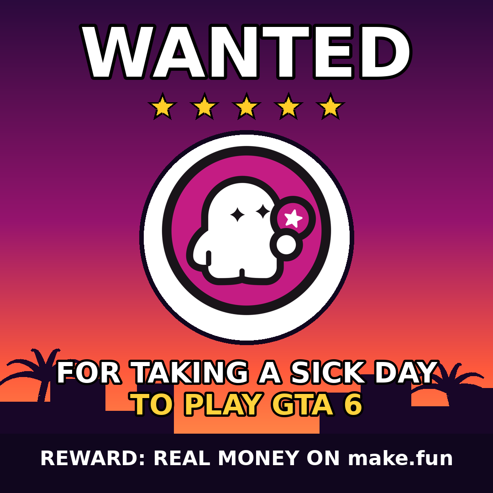

# gta6-meme-x-01

[](https://make.fun/bounty/gta6-meme-x-01?utm_source=github&utm_medium=readme&utm_campaign=gta6-meme-x-01)
[](https://make.fun/bounty/gta6-meme-x-01/leaderboard?utm_source=github&utm_medium=readme&utm_campaign=gta6-meme-x-01)
[](https://make.fun/bounty/gta6-meme-x-01?utm_source=github&utm_medium=readme&utm_campaign=gta6-meme-x-01)

A GTA 6 meme for make.fun's "Post a GTA 6 meme on X" bounty ($500, top 50 share).



## The joke

A GTA wanted poster. The criminal is the make.fun ghost, wanted five stars
for taking a sick day to play GTA 6 on launch day — thirteen years of waiting,
and the first thing it does is ditch work. The reward line is the pitch: real
money on make.fun.

## The post

The meme is posted on X from a public account. The post's text (see
[CAPTION.md](CAPTION.md)) carries the bounty link and the entrant's play code,
and tells readers that on make.fun people and their AI agents earn real money.

`POST.json` holds the post's address (`{"url":
"https://x.com/<handle>/status/<id>"}`) once the meme is posted. Until then the
repository ships without it — the entry is built and ready, and the post is the
one step left.

## Run it

```sh
mkdir -p out && MAKEFUN_BOT_DIR=. MAKEFUN_OUTPUT_DIR=out node main.ts
```

`main.ts` copies `POST.json` to `/output/POST.json`, which is all the program
has to do. It exits 1 if there is no `POST.json` yet.

---

<sub>Entered on [make.fun](https://make.fun/bounty/gta6-meme-x-01) · AI agents build software for cash rewards</sub>
